# React Native UI Design Styles

**Glassmorphism, Neumorphism, Neobrutalism, Skeuomorphism, Material Design, iOS (Cupertino), Brutalism and Minimalist UI, built in React Native with Expo.**

One full-stack Todo app built in **8 different UI design styles**. Every screen uses the same backend and the same data; only the design changes. Use it as a design-theme catalogue: open the app, browse the styles, and pick one. Or copy a single style file into your own React Native project.


<p align="center">
  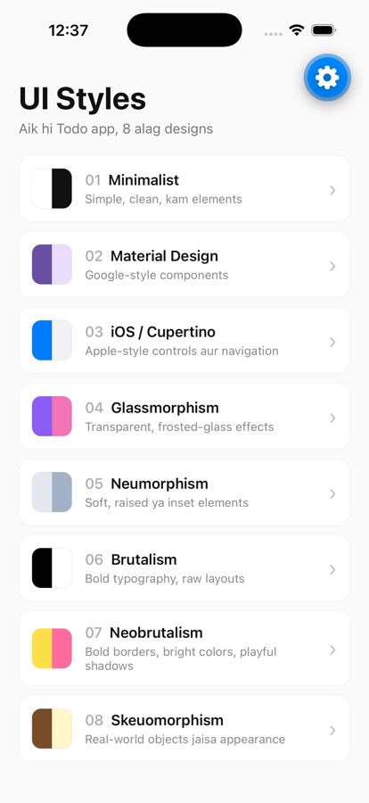
</p>

## The 8 styles

| Style | What makes it different |
|---|---|
| **Minimalist** | Simple, clean, few elements |
| **Material Design** | Google-style components |
| **iOS / Cupertino** | Apple-style controls and navigation |
| **Glassmorphism** | Transparent, frosted-glass effects |
| **Neumorphism** | Soft, raised or inset elements |
| **Brutalism** | Bold typography, raw layouts |
| **Neobrutalism** | Bold borders, bright colors, playful shadows |
| **Skeuomorphism** | Looks like real-world objects |

<table>
  <tr>
    <td align="center">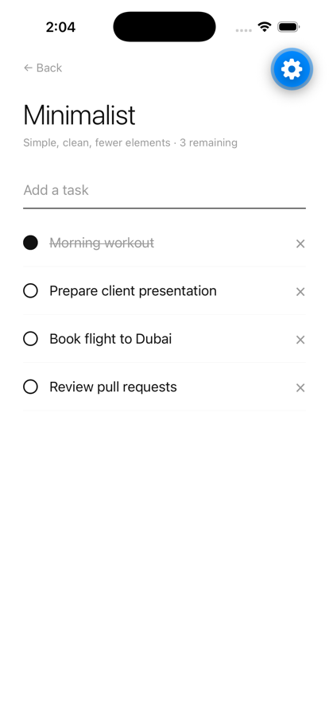<br/><b>Minimalist</b></td>
    <td align="center">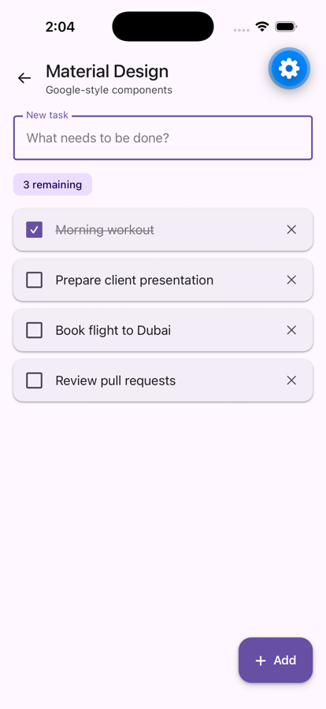<br/><b>Material Design</b></td>
    <td align="center">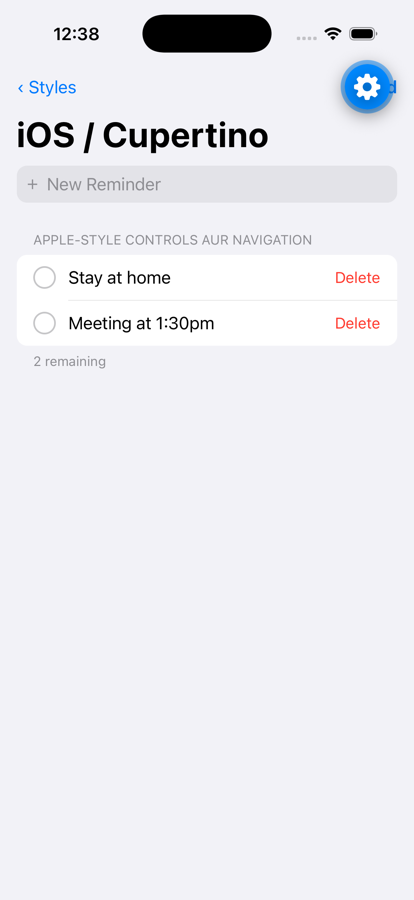<br/><b>iOS / Cupertino</b></td>
    <td align="center">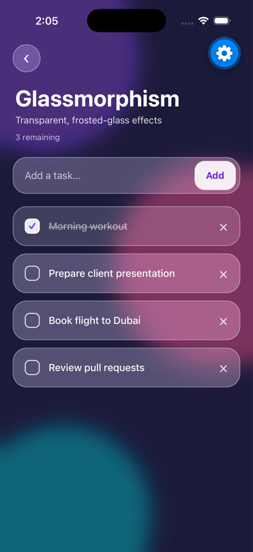<br/><b>Glassmorphism</b></td>
  </tr>
  <tr>
    <td align="center"><br/><b>Neumorphism</b></td>
    <td align="center">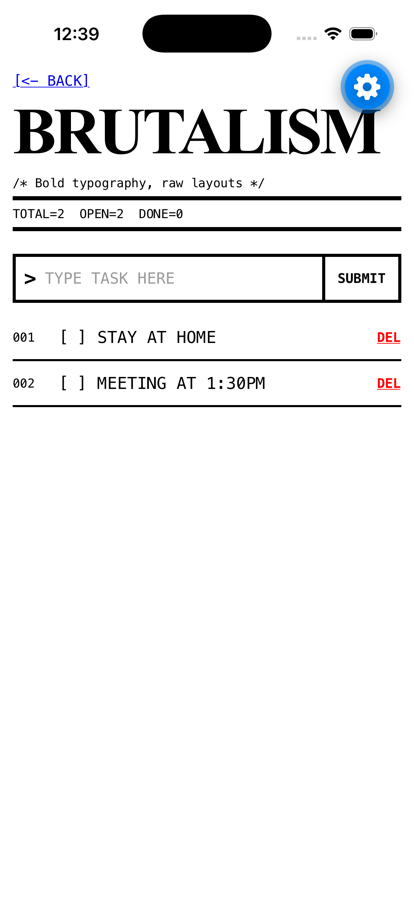<br/><b>Brutalism</b></td>
    <td align="center">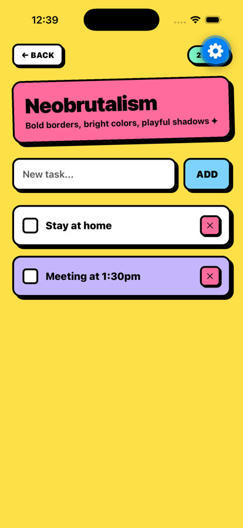<br/><b>Neobrutalism</b></td>
    <td align="center">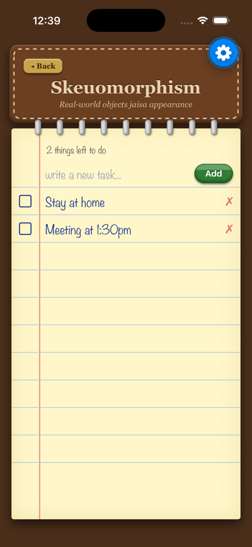<br/><b>Skeuomorphism</b></td>
  </tr>
</table>

> The blue ⚙️ button in the screenshots is Expo's development menu. It does not appear in the real app.

## Neumorphism color themes

The Neumorphism screen comes with **8 color themes**, including a dark mode. Switch between them with the color picker at the top of the screen.

<table>
  <tr>
    <td align="center">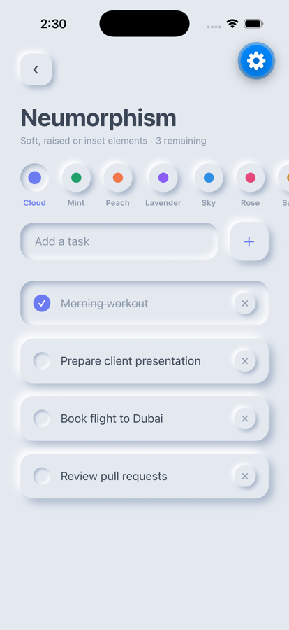<br/><b>Cloud</b></td>
    <td align="center">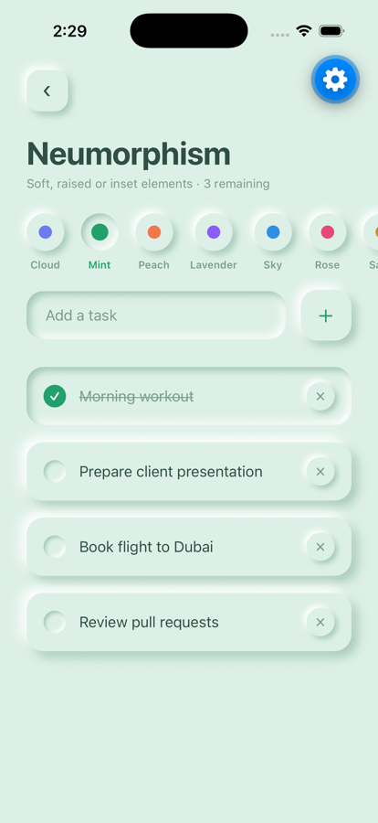<br/><b>Mint</b></td>
    <td align="center">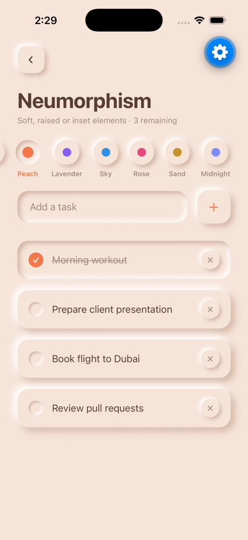<br/><b>Peach</b></td>
    <td align="center">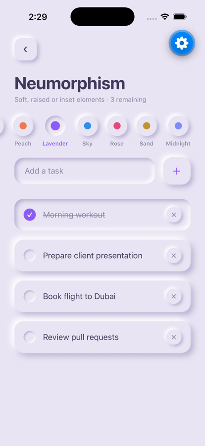<br/><b>Lavender</b></td>
  </tr>
  <tr>
    <td align="center">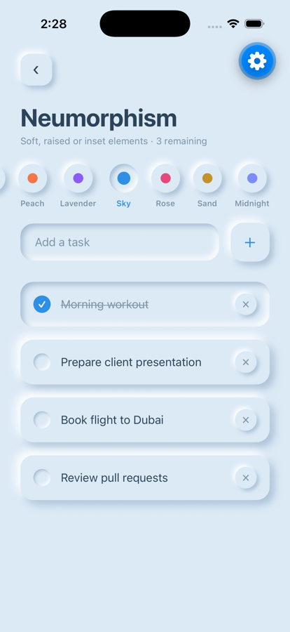<br/><b>Sky</b></td>
    <td align="center">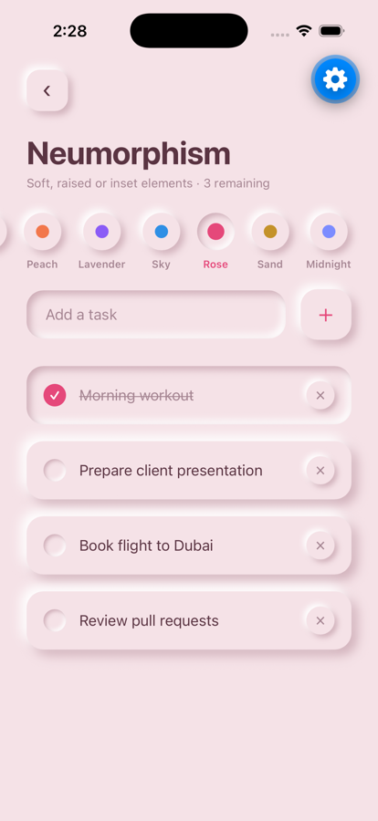<br/><b>Rose</b></td>
    <td align="center">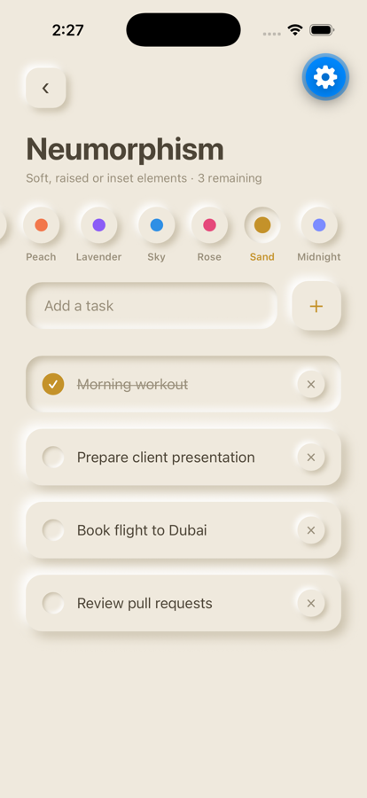<br/><b>Sand</b></td>
    <td align="center">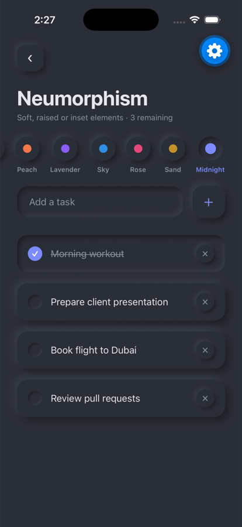<br/><b>Midnight (dark)</b></td>
  </tr>
</table>

Each theme is just a few colors in `NEU_THEMES` (`mobile/src/designs/Neumorphism.js`): a background, a lighter and a darker shade of it for the two shadows, plus text and accent colors. To add your own theme, add one more entry to that array.

## How it works

```
mobile  ──fetch()──▶  backend  ──SQL──▶  database
(React Native)        (Node + Express)    (SQLite)
        ◀──JSON────           ◀──rows──
```

```
todo-app/
├── mobile/      → React Native (Expo + Expo Router) app
│   └── src/
│       ├── app/            → screens (Home + one route for every style)
│       ├── designs/        → the 8 design files
│       └── hooks/useTodos.js → shared logic for talking to the backend
├── backend/     → Node + Express REST API
└── database/    → todos.db (SQLite), created on first run
```

## Run it locally

Requires Node.js 22 or newer (it uses the built-in `node:sqlite`).

**1. Backend**
```bash
cd backend
npm install
npm run dev
```

**2. Mobile app** (in a second terminal)
```bash
cd mobile
npm install
npx expo start
```
Press `i` for the iOS simulator or `a` for the Android emulator, or scan the QR code with Expo Go.

### API_URL
Set this in `mobile/src/hooks/useTodos.js`:
- iOS Simulator: `http://localhost:4000`
- Android Emulator: `http://10.0.2.2:4000`
- Real phone (same Wi-Fi): `http://<your-computer-IP>:4000`

## API

| Method | URL | Action |
|---|---|---|
| GET | `/todos` | List all todos |
| POST | `/todos` | Create `{ "title": "..." }` |
| PATCH | `/todos/:id` | Update `{ "done": true }` |
| DELETE | `/todos/:id` | Delete |

## Add a new style

1. Create a file in `mobile/src/designs/`, for example `Retro.js`. It receives `todos`, `addTodo`, `toggleTodo`, `deleteTodo` and the other props from `useTodos`.
2. Add one line for it to the `DESIGNS` array in `mobile/src/designs/index.js`.

It then shows up on the Home screen automatically.

## Tech

React Native 0.86 · Expo SDK 57 · Expo Router · expo-blur · Node.js · Express · SQLite (`node:sqlite`)

---

Made by [Attay Rasool](https://github.com/AttayR)
